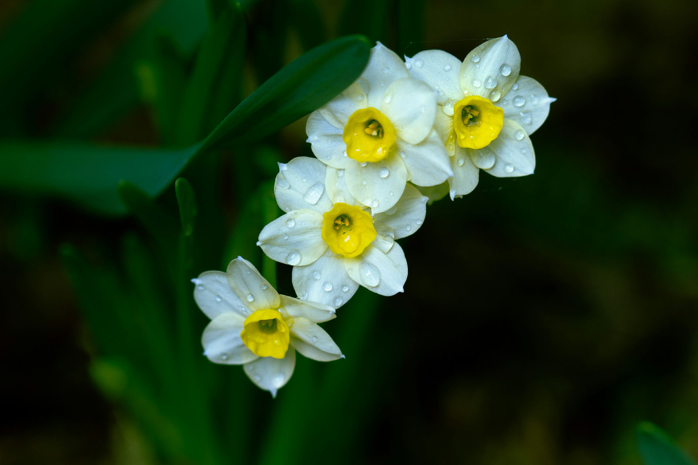

So why did I come all the way out here away from everyone? My nearest neighbor is a mile away, and there’s no house in sight unless you climb a hill half a mile away. It’s an amazing feeling to have my horizon completely encircled by woods, with no sign of human habitation.

From my little spot I have a distant view of the railroad where it touches the pond on one side, and the fence skirting the woodland road on the other. But most of the time, it’s as solitary here as being out on the prairies. It feels like I have my own private universe.
